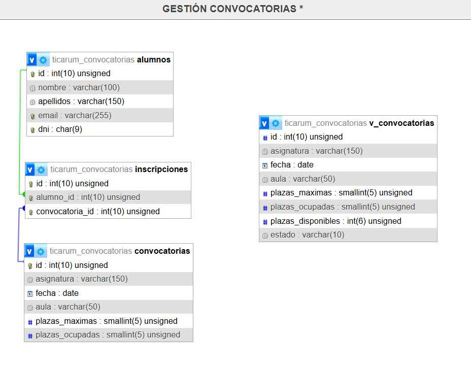

# TICARUM — Gestión de Convocat

orias

Aplicación web para gestionar convocatorias de examen e inscripciones de alumnos. Desarrollada en **PHP 8.2+ nativo, sin frameworks**, con arquitectura MVC clásica.

## Requisitos

- PHP **8.2** o superior (probado con 8.3)
- MariaDB 10.5+ o MySQL 8.0+
- Cualquier instalación tipo XAMPP, Laragon, MAMP, o stack manual con `php-cli` y `php-mysql`

No requiere Composer ni dependencias adicionales. Swagger UI se carga desde CDN.

## Instalación

### 1. Importar la base de datos

```bash
mysql -u root -p < sql/script_inicializacion_bd.sql
```

O desde phpMyAdmin: Importar ---> seleccionar `sql/script_inicializacion_bd.sql ---> Continuar.

El script crea la base de datos `ticarum_convocatorias`, sus 3 tablas, los triggers, la vista y datos de prueba que cubren todos los casos de validación (convocatoria llena, fecha pasada, conflicto de mismo día, alumnos con y sin inscripciones).



### 2. Configurar la conexión

Copia `config/config.example.php` a `config/config.php` y ajusta los valores según tu entorno:

```php
return [
    'db' => [
        'host' => '127.0.0.1',
        'name' => 'ticarum_convocatorias',
        'user' => 'root',
        'pass' => '',
    ],
];
```

### 3. Arrancar el servidor

Desde la raíz del proyecto:

```bash
php -S localhost:8000 -t public
```

## URLs

| URL | Descripción |
|---|---|
| `http://localhost:8000/` | Inicio (verifica conexión con la BD) |
| `http://localhost:8000/alumnos` | Gestión de alumnos |
| `http://localhost:8000/convocatorias` | Gestión de convocatorias |
| `http://localhost:8000/docs/` | **Documentación de la API (Swagger UI)** |
| `http://localhost:8000/openapi.yaml` | Especificación OpenAPI 3.0 en bruto |

## Estructura del proyecto

- **`app/`**
    - **`Controllers/`** — `HomeController`, `AlumnoController`, `ConvocatoriaController`, `InscripcionController`.
    - **`Core/`** — `Router`, `Database`, `Controller`
    - **`Models/`** — `Alumno`, `Convocatoria`, `Inscripcion`, `InscripcionException`.
    - **`Views/`** — `layout.php` + (`alumnos/`, `convocatorias/`).
- **`config/`** — `config.example.php` (sube al repo) y `config.php` (en `.gitignore`, credenciales reales).
    - **`index.php`** — front controller + rutas.
    - **`assets/`** — `css` y `js`.
    - **`openapi.yaml`** — especificación API.
    - **`docs/`** — Swagger UI.
- **`sql/schema.sql`** — esquema completo (tablas, triggers, vista) + datos de prueba.

## Pruebas

La carpeta `tests/` contiene una colección Postman (`TICARUM.postman_collection.json`)
con 18 requests que cubren los endpoints principales y los 7 casos de error
documentados en OpenAPI. Importarla en Postman y ejecutar con "Run collection".

## Resumen de funcionalidades

- **Alumnos**: CRUD completo. Validación de DNI español con módulo 23 de la letra de control. Unicidad de email y DNI. Bloqueo de borrado si hay inscripciones. Al clicar en un DNI del listado se abre un modal con las convocatorias en las que el alumno está inscrito.
- **Convocatorias**: CRUD completo. El listado muestra estado calculado (`abierta` / `completa` / `finalizada`). El detalle incluye los alumnos inscritos y permite alta/baja de inscripciones desde un combo buscable.
- **Inscripciones**: AJAX con JSON puro (REST). Las 4 validaciones del enunciado se aplican dentro de una **transacción SQL con `SELECT ... FOR UPDATE`** sobre la convocatoria.
- **API documentada**: OpenAPI 3.0 con Swagger UI interactivo en `/docs/`.
